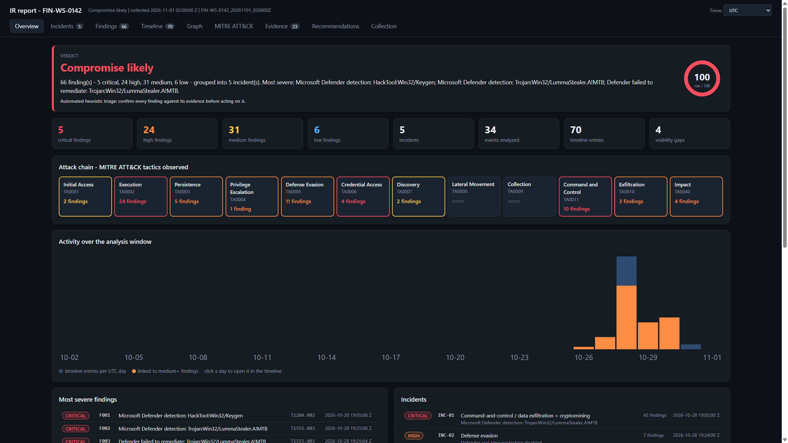
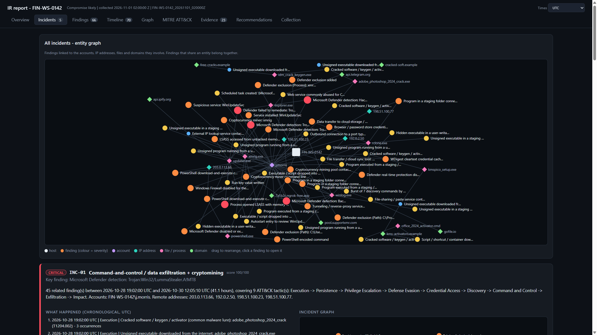
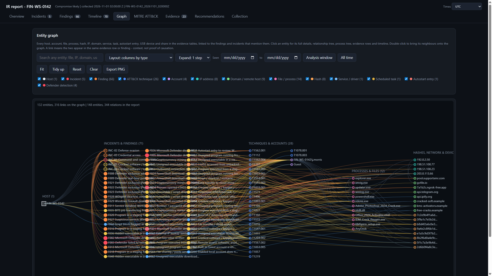
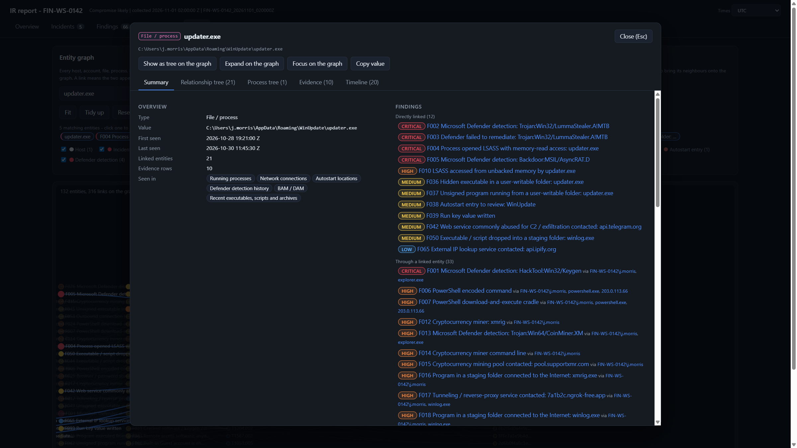
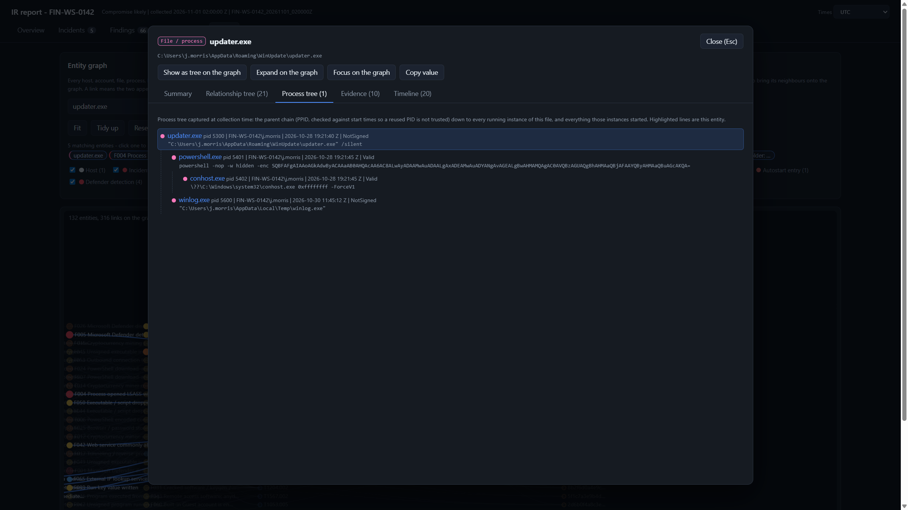

# IR-Investigator

**One PowerShell script for Windows incident response and forensic triage.**

IR-Investigator collects live state, raw forensic artifacts and the complete event logs from a Windows host, analyzes them the way a DFIR analyst would, maps every finding to **MITRE ATT&CK**, groups related findings into **incidents**, and writes a single self-contained **HTML dashboard** with evidence, timeline, incident graph and ATT&CK matrix.

No installation, no modules, no internet access required - just Windows PowerShell 5.1.



> **Try it without running anything:** download [`Sample-Report-Infected-FIN-WS-0142.html`](Sample-Report-Infected-FIN-WS-0142.html) and open it in a browser. It is a report generated from a fully synthetic, heavily infected workstation (infostealer, RAT, cryptominer, data exfiltration). See [`SAMPLE-REPORT.md`](SAMPLE-REPORT.md).

---

## Features

- **Single file, zero dependencies** - runs on Windows 10/11 and Windows Server with the built-in PowerShell 5.1.
- **Three modes** - collect + analyze on the host, collect only (minimal footprint), or analyze an existing case offline on the analyst workstation.
- **Broad collection** - processes with command lines and hashes, network connections, DNS cache, services, scheduled tasks, Run keys, WMI subscriptions, startup folders, Defender state, users and sessions, every non-empty `.evtx` log, registry hives, Prefetch, Amcache, SRUM, Jump Lists, LNK files, browser history, PowerShell history and more.
- **Analyst-style detection** - rules over event logs (Security, Sysmon, PowerShell, Defender, RDP, WinRM, Task Scheduler, ...), live state and raw artifacts: encoded PowerShell, LOLBins, credential dumping, Office spawning shells, persistence, defense evasion, lateral movement, C2, tunneling, exfiltration tools, cryptominers, cracked-software lures, and multi-step correlation rules.
- **MITRE ATT&CK mapping** - every finding carries a technique and tactic, rendered as an attack chain and a full matrix.
- **Incident grouping** - findings that share an account, IP, process, file, hash or domain are merged into incidents with a chronological narrative, affected entities and targeted recommendations.
- **Interactive dashboard** - overview, incidents, findings, timeline, entity graph with process trees, ATT&CK matrix, evidence browser, recommendations and collection log, all in one offline HTML file.
- **Chain of custody** - SHA-256 manifest of every collected file, verified archive (`.zip` or password-protected `.rar`) with its own `.sha256`.
- **Self-noise filtering** - the script recognizes and excludes its own activity from the analysis.

## Screenshots

| Incidents | Entity graph |
|---|---|
|  |  |

| Entity details | Process tree (parent chain) |
|---|---|
|  |  |

## Requirements

| | |
|---|---|
| OS | Windows 10 / 11, Windows Server (any version with PowerShell 5.1) |
| PowerShell | Windows PowerShell 5.1 (built in). PowerShell 7 also works. |
| Privileges | **Administrator** for `Collect` / `All` (event logs, locked hives, other users' data). `Analyze` needs no elevation. |
| Optional | WinRAR / `rar.exe` for `-Archive Rar` |

## Quick start

Open an **elevated** PowerShell window in the folder containing the script:

```powershell
# Allow the script for this session only
Set-ExecutionPolicy -Scope Process -ExecutionPolicy Bypass -Force

# If the file was downloaded from the internet, remove the Mark-of-the-Web
Unblock-File .\IR-Investigator.ps1

# Collect (Standard profile), analyze the last 30 days, write the report, package the case
.\IR-Investigator.ps1
```

When it finishes, the report opens in your default browser (use `-NoOpen` to suppress this).

More examples:

```powershell
# Fast live-triage collection only, written straight to a share
.\IR-Investigator.ps1 -Mode Collect -Profile Quick -OutputRoot \\ir-share\cases

# Analyze a collected case on the analyst workstation, last 90 days
.\IR-Investigator.ps1 -Mode Analyze -CasePath D:\IRCollection\HOST01_20261031_120000Z.zip -Days 90

# Full collection, encrypted RAR archive, case metadata in the report
.\IR-Investigator.ps1 -Profile Full -Archive Rar -ArchivePassword 'S3cret!' -CaseLabel INC-2026-044 -Examiner 'Jane Doe'
```

## Modes

| Mode | What it does |
|---|---|
| `All` (default) | Collect on this host, analyze, write the report, then package the case. |
| `Collect` | Collect and package only - the lightest footprint on a suspect host. |
| `Analyze` | Analyze an existing case folder or `.zip` and write the report. Changes nothing on the analyst host. |

## Collection profiles

| Profile | Contents | Typical time |
|---|---|---|
| `Quick` | Live state + the key event logs | a few minutes |
| `Standard` (default) | + every non-empty event log, registry hives (SYSTEM, SOFTWARE, NTUSER, UsrClass), Prefetch, Amcache, SRUM, Jump Lists, LNK, browser history, PowerShell history, Recycle Bin metadata, scheduled task files, Defender logs | about 4-10 minutes |
| `Full` | + SAM and SECURITY hives, thumbcache, WMI repository, RDP bitmap cache, alternate data streams, deeper file scan | longer |

## Parameters

| Parameter | Default | Description |
|---|---|---|
| `-Mode` | `All` | `All`, `Collect` or `Analyze` |
| `-Profile` / `-CollectionProfile` | `Standard` | `Quick`, `Standard` or `Full` |
| `-OutputRoot` | `D:\IRCollection` | Where the case folder is created. Falls back to `C:\Windows\Temp\IRCollection` if `D:` is missing. UNC paths work. |
| `-CasePath` | | `Analyze` mode: a case folder or the `.zip` produced by `Collect` |
| `-Days` | `30` | Analysis window in days before the collection time |
| `-MaxEventsPerLog` | `50000` | Maximum events parsed per log (newest first) |
| `-Archive` | `Zip` | `Zip`, `Rar` (encrypts names and content) or `None` |
| `-ArchivePassword` | `infected` | Password for `-Archive Rar`. Visible in process-creation telemetry. |
| `-KeepCaseFolder` | off | Keep the case folder after the archive has been verified |
| `-CaseLabel` | | Case / ticket identifier shown in the report |
| `-Examiner` | | Examiner name shown in the report |
| `-NoOpen` | off | Do not open the report in the browser when finished |

Full help is built in: `Get-Help .\IR-Investigator.ps1 -Full`

## Output

```
<OutputRoot>\<HOST>_<yyyyMMdd_HHmmss>Z\
  live\*.json             normalized live state (processes, network, persistence, ...)
  eventlogs\*.evtx        complete event logs
  artifacts\...           raw artifacts copied unmodified (for EZ Tools, RegRipper, Hindsight, ...)
  report\IR-Report.html   the dashboard (Analyze / All)
  manifest.csv            SHA-256 of every collected file (chain of custody)
  collection.log          what ran, what failed
<HOST>_<timestamp>Z.zip   packaged case
<HOST>_<timestamp>Z.zip.sha256
```

## How it works

```
Collect ──► live\*.json + eventlogs\*.evtx + artifacts\
               │
Analyze ──►  event-log rules ─┐
             live-state rules ├─► findings (severity + MITRE technique + evidence)
             artifact rules  ─┘          │
                                         ├─► correlation rules (multi-step patterns)
                                         ├─► incidents (union-find over shared entities)
                                         ├─► verdict, score, recommendations, IOCs
                                         └─► report\IR-Report.html
```

Every finding links back to the exact evidence (event record, process, registry value, file) it came from. The [full documentation](DOCUMENTATION.md) describes every phase, the ATT&CK mapping, the scoring model, the incident algorithm and the complete rule reference.

## Documentation

- [Full documentation](DOCUMENTATION.md) - architecture, collection, analysis, MITRE mapping, scoring, incidents, report, rule reference, limitations, troubleshooting
- [Sample report](Sample-Report-Infected-FIN-WS-0142.html) and [what it demonstrates](SAMPLE-REPORT.md)

## Antivirus / EDR note

The script contains detection patterns for real attacker techniques (credential dumping commands, AMSI tampering, download cradles, Defender exclusions, etc.) as plain strings in its rule tables. Some antivirus or EDR products may therefore flag the **file itself** as suspicious even though it never executes those techniques. If this happens:

- verify the file hash against the one you downloaded,
- review the source - it is a single readable text file,
- add a scoped, temporary exclusion if your policy allows it, or run it from your IR toolkit share.

Running the collector on a host also generates telemetry (PowerShell, process creation, file access). The analysis phase recognizes and filters its own activity, but your SOC may still see it - coordinate before running on monitored systems.

## Limitations

- The analysis is **heuristic triage**, not a verdict. Every finding must be confirmed by an analyst against its evidence.
- Detection quality depends on what was logged. Missing Sysmon, disabled PowerShell logging or small log sizes are reported as **visibility gaps**.
- Raw artifacts (hives, Prefetch, Amcache, SRUM, ...) are collected for validated forensic parsers; the built-in artifact analysis is intentionally lightweight.
- No memory acquisition. Pair it with a dedicated memory tool when volatile evidence matters.

See [Limitations](DOCUMENTATION.md#14-limitations) for details.

## Disclaimer

This tool is intended for **authorized** incident response, forensic investigation and security assessment only. Run it only on systems you own or are explicitly permitted to investigate. It is provided as-is, without warranty; the authors are not responsible for misuse or for decisions made solely on its automated output.

## License

Released under the [MIT License](LICENSE).
